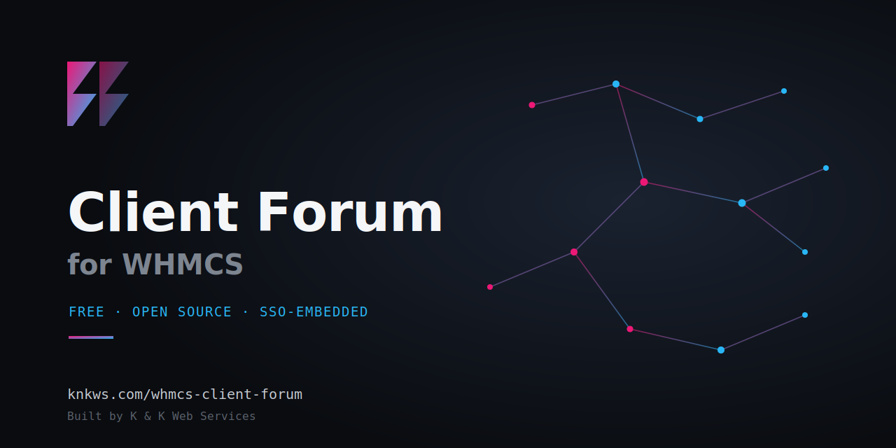

<p align="center"></p>

# Client Forum for WHMCS

A free WHMCS addon module that embeds a discussion forum directly inside your client area — using each client's existing WHMCS login, with no separate registration required.

Built by [K & K Web Services](https://knkws.com).

## Features

- **Single sign-on** — clients post using the login they already have, no second account
- **Categories, boards, threads, and replies** — standard forum structure
- **Product-gated boards** — restrict specific boards to clients who own a given product/service
- **Markdown / rich-text editor** for post bodies
- **Best-answer marking** and **points/karma** system
- **Leaderboard** of top contributors
- **Ticket-to-thread promotion** — turn a support ticket into a public forum thread in one click
- **Full-text search** across thread titles and post bodies (MySQL FULLTEXT)
- **Slack / Discord webhook notifications** on new threads and ticket promotions
- **Admin tools** — full category/board CRUD, moderation, reordering, and the ability to post new threads directly from the admin panel
- **Dashboard widget** for a quick activity overview
- **Rate limiting** to curb spam/flooding
- **Staff badges** so client-facing replies from your team stand out
- **English and Spanish** language support out of the box
- Users can **edit their own posts**, including the thread title on the opening post

## Requirements

- WHMCS 8.x
- PHP 7.4+
- MySQL/MariaDB with FULLTEXT index support

## Installation

1. Download or clone this repository.
2. Copy the `modules/addons/clientforum` folder into your WHMCS installation's `modules/addons/` directory.
3. In the WHMCS admin panel, go to **Setup → Addon Modules**, find **Client Forum**, and click **Activate**.
4. Configure access permissions and any product-gating rules from the module's admin settings page.
5. (Optional) Add your Slack or Discord webhook URL in the module settings to enable notifications.

## Free vs. Pro

Everything listed above is fully free and unlimited — no license key required.

A Pro tier is in development with additional features (reactions, user profile pages, canned responses, thread merge/split, multi-staff ticket assignment, and more). See [knkws.com/whmcs-client-forum](https://knkws.com/whmcs-client-forum/) for current availability and pricing.

## Troubleshooting

**The client area menu doesn't show on the forum page.**
Some third-party themes only show the client menu (Home, Services, Domains, Billing…) on a fixed list of pages. Find the template file that controls your theme's client menu (usually in `templates/YOUR-THEME/includes/`), look for the long `{if ...}` line listing pages like `clientarea` and `submitticket`, and add this before the closing `}`:

```
|| $smarty.get.m eq "clientforum"
```

Re-apply the change after any theme update. The standard WHMCS themes (Twenty-One, Six) are not affected.

**Search doesn't find very short words.**
MySQL full-text search skips words under 3 characters and common stopwords ("the", "and"). Search with a longer or more specific word.

## Support

- Issues and bug reports: use the [Issues](../../issues) tab on this repository
- General questions / Pro inquiries: [Support@knkws.com](mailto:Support@knkws.com)

## License

Free to use on any number of WHMCS installations. See repository for details.
